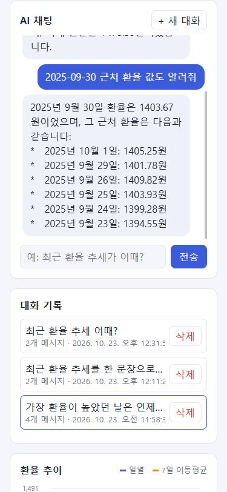
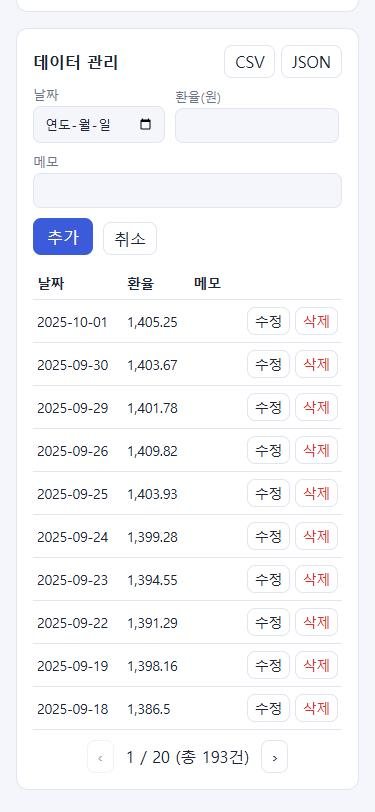
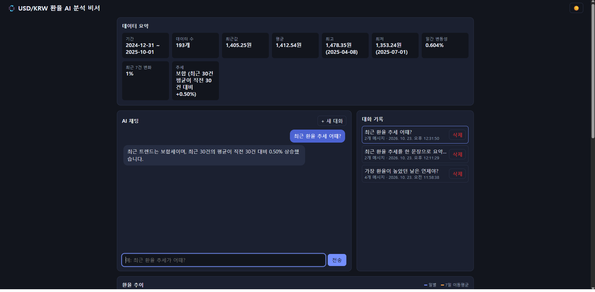
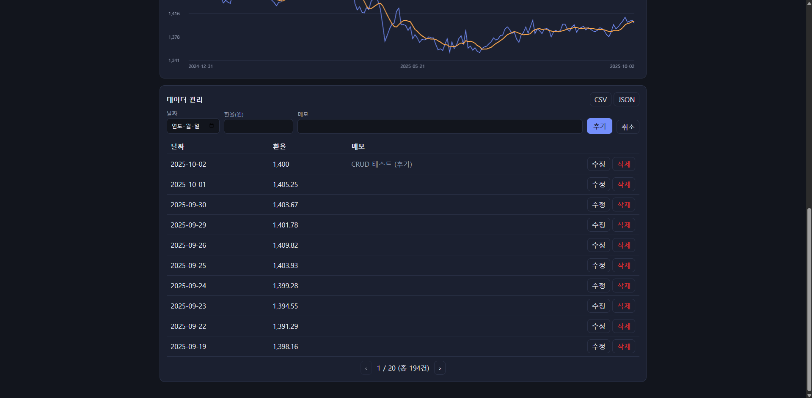
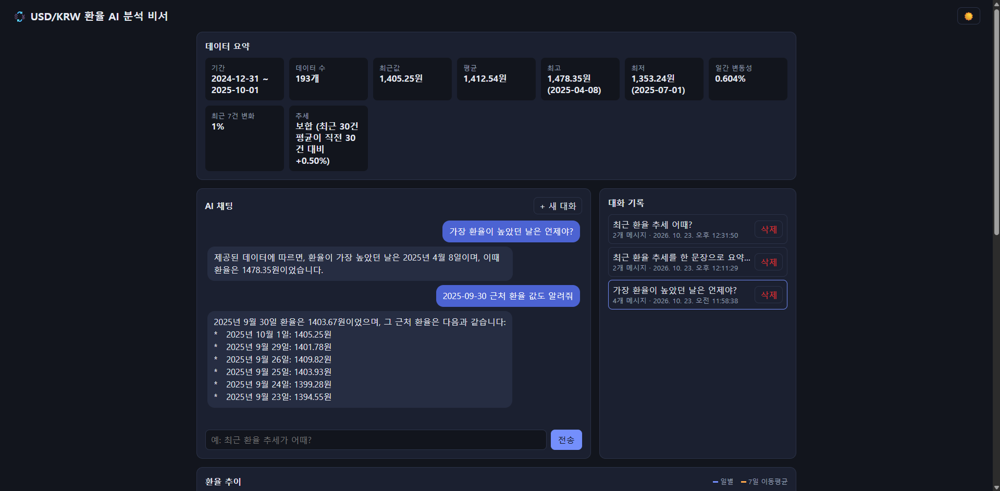

# 💱 USD/KRW 환율 AI 분석 비서

저장된 환율(USD/KRW) 시계열 데이터를 분석해 **요약 정보를 만들고, 이를 시스템 프롬프트에 주입(컨텍스트 주입)** 해
데이터에 근거한 답변을 주는 AI 채팅 서비스입니다. 데이터 CRUD, 대화 기록 저장/불러오기, 추세 그래프, CSV/JSON 내보내기, 다크 모드를 포함합니다.

## 과제 요구사항 충족 체크리스트

| 요구사항 | 구현 위치 |
|---|---|
| 데이터 100개 이상 + 요약(기간/개수/통계/추세) | `data/usd_krw.csv`(193건), `backend/app/services/summary_service.py` |
| FastAPI + CORS + Swagger(`/docs`) | `backend/main.py` |
| Firestore 연동(`data`, `conversations` 컬렉션), 키는 환경변수 | `backend/app/store.py`, `app/config.py` |
| 데이터 API 5개 (POST/GET/PUT/DELETE + summary) | `backend/app/routers/data.py` |
| 대화 API (POST/GET/DELETE + `GET /{id}` 방식 A) | `backend/app/routers/conversations.py` |
| `POST /api/chat` (요약 조회 → 프롬프트 주입 → GPT → 자동 저장) | `backend/app/services/chat_service.py` |
| 바닐라 프론트 (채팅+로딩, 데이터 CRUD, 대화 기록, 요약 표시) | `frontend/` |
| Render / Vercel 배포 설정, 콜드스타트 안내 | `render.yaml`, `frontend/vercel.json`·`build.js`, 프론트 배너 |
| 보너스 1: Function Calling + MCP | `chat_service.py`(TOOLS), `backend/mcp_server/server.py` |
| 보너스 2: 추가 지표, 그래프, CSV/JSON 내보내기, 다크 모드 | `summary_service.py`, `/api/data/statistics`, `/api/data/export`, `frontend/app.js` |

## 실제 API 응답 예시

`GET /api/data/summary` (샘플 데이터 193건 기준, 실제 실행 결과):

```json
{
  "period": "2024-12-31 ~ 2025-10-01",
  "count": 193,
  "metrics": {
    "latest": 1405.25, "latest_date": "2025-10-01",
    "average": 1412.54,
    "max": 1478.35, "max_date": "2025-04-08",
    "min": 1353.24, "min_date": "2025-07-01",
    "volatility_pct": 0.604, "change_7d_pct": 1.0
  },
  "trend": "보합 (최근 30건 평균이 직전 30건 대비 +0.50%)"
}
```

챗봇에 주입되는 시스템 프롬프트 (`chat_service.py`):

```text
당신은 USD/KRW 환율 데이터 분석 비서입니다.

[사용자 데이터 요약]
- 데이터 기간: 2024-12-31 ~ 2025-10-01
- 총 레코드: 193개
- 최근값: 1405.25원 (2025-10-01)
- 평균: 1412.54원 / 최고: 1478.35원 (2025-04-08) / 최저: 1353.24원 (2025-07-01)
- 일간 변동성(표준편차): 0.604% / 최근 7건 변화율: 1.0%
- 최근 트렌드: 보합 (최근 30건 평균이 직전 30건 대비 +0.50%)

위 데이터를 기반으로 맞춤형 답변을 제공하세요. (수치 지어내지 않기, 투자 권유 금지, 상세값은 도구 호출)
```

## 설계 설명 (학습 목표)

- **시계열 요약 → 서비스 활용**: 날짜순 정렬 후 기간·개수·평균·최대·최소·변동성을 계산하고, 최근 30건 평균과 직전 30건 평균을 비교해 상승/하락/보합(±0.5%)을 판정합니다. 이 요약을 API(`/summary`)로도 제공하고 챗봇 프롬프트에도 재사용합니다.
- **라우터/서비스 분리**: `routers`는 HTTP 입출력·상태코드, `services`는 계산·저장·GPT 로직, `store.py`는 DB 접근만 담당합니다. 챗봇 도구 호출이 라우터 없이 같은 서비스를 재사용하고, DB 교체 시 한 파일만 바꿉니다.
- **Pydantic 검증**: 잘못된 값이 DB·GPT 프롬프트로 들어가는 것을 막기 위해 요청 단계에서 타입·범위·길이를 검증하고, 실패 시 자동으로 422와 사유를 돌려줍니다 (`app/schemas.py`).
- **Firestore CRUD**: `data`(date, value, memo), `conversations`(title, messages[], created_at, updated_at) 두 컬렉션. 문서 ID를 `id`로 노출해 수정/삭제에 사용합니다.
- **컨텍스트 주입**: GPT는 우리 DB를 모르므로, 매 요청마다 최신 요약을 계산해 시스템 프롬프트에 넣습니다. 전체 데이터(193건)를 넣는 것보다 토큰이 적고, 답변이 실제 수치에 근거하며 데이터가 바뀌면 답변도 바뀝니다.

## 배포 URL

| 구분 | URL |
|---|---|
| 프론트엔드 (Vercel) | https://fx-ai-assistant-frontend.vercel.app |
| 백엔드 API (Render) | https://fx-ai-assistant.onrender.com |
| Swagger UI | https://fx-ai-assistant.onrender.com/docs |

> ⏳ Render 무료 티어는 15분간 요청이 없으면 슬립합니다. 첫 요청은 30~60초 걸릴 수 있으며, 프론트가 3초 이상 응답이 없으면 "서버를 깨우는 중" 안내를 표시합니다.

## 기술 스택

- **Backend**: Python 3.10+, FastAPI, Pydantic, firebase-admin(Firestore), openai, python-dotenv
- **Frontend**: Vanilla HTML/CSS/JavaScript (프레임워크 없음, Canvas 그래프)
- **Infra**: Render(백엔드), Vercel(프론트), Firebase Firestore(DB)

## 데이터와 요약 흐름

- 데이터: 2025-01 ~ 2025-10 USD/KRW 일별 환율 **193건** (`data/usd_krw.csv`, [Frankfurter API](https://frankfurter.dev) 수집)
- `GET /api/data/summary` → 기간, 개수, 평균/최고/최저/최근값, 변동성, 7건 변화율, 추세(최근 30건 평균 vs 직전 30건 평균)
- `POST /api/chat` 흐름: **요약 조회 → 시스템 프롬프트에 삽입 → GPT 호출 → conversations에 자동 저장**

```
사용자 질문 ─▶ /api/chat ─▶ build_summary() ─▶ 시스템 프롬프트 {요약} 주입 ─▶ GPT
                                                        │  (필요 시 도구 호출)
                                                        ▼
                                      답변 ─▶ Firestore conversations 자동 저장 ─▶ 응답
```

## 프로젝트 구조

```
backend/
  main.py                # 앱 초기화, CORS, 라우터 등록
  app/config.py          # 환경변수
  app/store.py           # Firestore 연동 (USE_MEMORY_DB=true면 로컬 테스트용 메모리 DB)
  app/schemas.py         # Pydantic 요청/응답 검증
  app/routers/           # data, conversations, chat (HTTP 계층)
  app/services/          # 비즈니스 로직 (요약 계산, 대화 저장, GPT 호출)
  scripts/seed_data.py   # 샘플 데이터 업로드
  mcp_server/server.py   # [보너스] MCP 서버
frontend/                # index.html, style.css, app.js, build.js, vercel.json
data/usd_krw.csv         # 샘플 데이터
```

라우터는 요청/응답 처리만, 서비스는 계산·저장 로직만 담당하도록 분리했습니다. 라우터를 건드리지 않고 서비스(예: 요약 계산)만 단독 테스트/재사용할 수 있고(챗봇 도구 호출도 같은 서비스를 재사용), 저장소 교체도 `store.py` 한 곳에서 끝납니다.

## API

| Method | Path | 설명 |
|---|---|---|
| POST | `/api/data` | 데이터 추가 `{date, value, memo}` |
| GET | `/api/data` | 목록 (날짜 오름차순) |
| PUT | `/api/data/{id}` | 수정 |
| DELETE | `/api/data/{id}` | 삭제 |
| GET | `/api/data/summary` | 요약 (프롬프트 주입용) |
| GET | `/api/data/statistics` | [보너스] 월별 통계 + 7일 이동평균 |
| GET | `/api/data/export?format=csv\|json` | [보너스] 내보내기 |
| POST | `/api/conversations` | 대화 저장 |
| GET | `/api/conversations` | 목록 (**messages 미포함**, `message_count` 포함) |
| GET | `/api/conversations/{id}` | 전체 messages 조회 (불러오기, 방식 A) |
| DELETE | `/api/conversations/{id}` | 삭제 |
| POST | `/api/chat` | `{message, conversation_id?}` → `{reply, conversation_id, tools_used, saved}` |

입력 검증(Pydantic): `date`는 유효한 YYYY-MM-DD, `value`는 0 초과 숫자, `memo`는 200자 이하, 채팅 메시지는 1~1000자. 잘못된 입력은 422, 없는 id는 404, AI 호출 실패는 502로 응답합니다.

## 로컬 실행

사전 준비: Python 3.10+, Firebase 프로젝트(Firestore **네이티브 모드** 생성) → 프로젝트 설정 > 서비스 계정 > **새 비공개 키 생성**, OpenAI API 키.

```bash
cd backend
python -m venv venv
source venv/Scripts/activate        # Windows PowerShell: venv\Scripts\Activate.ps1 / macOS·Linux: source venv/bin/activate
pip install -r requirements.txt
cp .env.example .env                # 값 채우기 (아래 환경 변수 참고)
uvicorn main:app --reload           # http://127.0.0.1:8000/docs
```

```bash
# 샘플 데이터 193건 업로드 (백엔드 실행 중에)
python scripts/seed_data.py

# 프론트엔드 (다른 터미널) — 로컬 기본 API 주소는 frontend/config.js
cd frontend
python -m http.server 5500          # http://localhost:5500
```

> Firebase 없이 UI만 시험하려면 `.env`에 `USE_MEMORY_DB=true`. 재시작하면 데이터가 사라지며 **배포에서는 사용 금지**입니다.

## 환경 변수

**백엔드 (Render)**

| 이름 | 설명 |
|---|---|
| `OPENAI_API_KEY` | OpenAI API 키 |
| `FIREBASE_SERVICE_ACCOUNT_JSON` | 서비스 계정 JSON **전체 내용**(한 줄). 로컬에서는 `FIREBASE_SERVICE_ACCOUNT_PATH`(파일 경로)도 가능 |
| `ALLOWED_ORIGINS` | CORS 허용 도메인(쉼표 구분). 예: https://fx-ai-assistant-frontend.vercel.app |
| `OPENAI_BASE_URL` | (선택) OpenAI 호환 API 주소. 비우면 OpenAI 공식 API |
| `OPENAI_MODEL` / `OPENAI_MAX_TOKENS` | (선택) 기본 `gpt-4o-mini` / `500` — 비용 제어 |

> **LLM 제공자 안내**: 백엔드는 `openai` SDK(Chat Completions + tool calling)로 구현되어 있습니다. 개발·제출 환경에서는 **과금 없이 테스트하기 위해 Google Gemini의 OpenAI 호환 엔드포인트**(`OPENAI_BASE_URL=https://generativelanguage.googleapis.com/v1beta/openai/`, `OPENAI_MODEL=gemini-2.5-flash`)를 사용했습니다. OpenAI GPT로 바꾸려면 `OPENAI_BASE_URL`을 비우고 `OPENAI_API_KEY`에 OpenAI 키, `OPENAI_MODEL`에 `gpt-4o-mini`를 넣으면 코드 수정 없이 동작합니다.

**프론트엔드 (Vercel)**

| 이름 | 설명 |
|---|---|
| `API_BASE_URL` | 백엔드 주소. 빌드 시 `build.js`가 `config.js`로 주입 |

### 왜 CORS / 환경변수 / 키 관리가 필요한가
- **CORS**: 프론트(vercel.app)와 백엔드(onrender.com)는 출처가 달라 브라우저가 기본적으로 차단합니다. `ALLOWED_ORIGINS`로 신뢰하는 프론트 도메인만 허용합니다(`*` 사용 금지).
- **환경변수/키 관리**: OpenAI 키와 Firebase 서비스 계정 키는 노출되면 과금·데이터 유출로 직결됩니다. 코드/Git에 넣지 않고 배포 플랫폼의 비밀 설정으로 주입합니다(`.gitignore`에 `.env`, 키 파일 포함).

## 배포

**백엔드 (Render)**: GitHub 푸시 → Render > New > Web Service → 저장소 선택 (루트의 `render.yaml` 사용 가능, 또는 Root Directory `backend`, Build `pip install -r requirements.txt`, Start `uvicorn main:app --host 0.0.0.0 --port $PORT`) → 위 환경변수 입력 → 배포 후 `/docs` 확인 → `python scripts/seed_data.py https://<your-api>.onrender.com`.

**프론트엔드 (Vercel)**: New Project → 같은 저장소, Root Directory `frontend` → 환경변수 `API_BASE_URL` 입력 → Deploy. 이후 Vercel 도메인을 Render의 `ALLOWED_ORIGINS`에 추가하세요.

## [보너스] Function Calling & MCP

`/api/chat`은 항상 요약을 시스템 프롬프트에 주입하며, 추가로 GPT가 필요하다고 판단하면 다음 도구를 호출합니다(최대 3회 반복). 응답의 `tools_used`와 화면 말풍선 하단(🔧)에 호출 내역이 표시됩니다.

| 도구 | 호출 근거 예시 |
|---|---|
| `get_data_summary` | "전체 통계 다시 알려줘" 등 최신 요약이 필요할 때 |
| `get_recent_data(limit)` | "어제/지난주 환율은?"처럼 요약에 없는 개별 일자 값이 필요할 때 |
| `list_conversations` | "내가 예전에 뭐 물어봤지?" |
| `get_conversation(id)` | 특정 이전 대화 내용을 참조해야 할 때 |

```
질문 → GPT(요약 주입됨) ─ 요약으로 충분 ─▶ 바로 답변
                        └ 상세값 필요 ─▶ tool_call(get_recent_data) ─▶ 서버가 서비스 실행 ─▶ 결과를 GPT에 전달 ─▶ 답변
```

**MCP 서버** (`backend/mcp_server/server.py`): 같은 4개 기능을 외부 클라이언트(Claude Desktop 등)에서 호출합니다.

```bash
pip install mcp httpx
```
Claude Desktop `claude_desktop_config.json`:
```json
{ "mcpServers": { "fx-ai-assistant": {
  "command": "python", "args": ["<절대경로>/backend/mcp_server/server.py"],
  "env": { "API_BASE_URL": "https://<your-api>.onrender.com" } } } }
```

## Firestore 저장 구현과 실행 증거

### 구현 (`backend/app/store.py`)

서비스 계정 키는 환경변수(`FIREBASE_SERVICE_ACCOUNT_JSON` 또는 `_PATH`)에서만 읽고, `firebase_admin`으로 초기화한 뒤 `firestore.client()`로 `data`·`conversations` 컬렉션을 다룹니다.

```python
class FirestoreStore:
    def __init__(self):
        if not firebase_admin._apps:
            if config.FIREBASE_SERVICE_ACCOUNT_JSON:
                cred = credentials.Certificate(json.loads(config.FIREBASE_SERVICE_ACCOUNT_JSON))
            elif config.FIREBASE_SERVICE_ACCOUNT_PATH:
                cred = credentials.Certificate(config.FIREBASE_SERVICE_ACCOUNT_PATH)
            else:
                raise RuntimeError("FIREBASE_SERVICE_ACCOUNT_JSON 또는 _PATH 환경변수가 필요합니다.")
            firebase_admin.initialize_app(cred)
        self.db = firestore.client()

    def add(self, col, data):           # Create
        _, ref = self.db.collection(col).add(data); return ref.id
    def list(self, col):                # Read (목록)
        return [{"id": d.id, **d.to_dict()} for d in self.db.collection(col).stream()]
    def get(self, col, doc_id):         # Read (단건)
    def update(self, col, doc_id, data) # Update — 없는 id면 False → 라우터가 404
    def delete(self, col, doc_id)       # Delete — 없는 id면 False → 라우터가 404
```

### 실행 증거 (배포 서버 `https://fx-ai-assistant.onrender.com` 에서 실제로 받은 응답)

- `GET /health` → `200 {"status":"ok"}`, `GET /docs` → `200` (Swagger UI)
- `GET /api/data` → `200`, **193건** (Firestore `data` 컬렉션). 마지막 문서:

```json
{"id": "NlvSMrKJptFW1Q2wagiD", "date": "2025-10-01", "value": 1405.25, "memo": ""}
```

- 데이터 추가(POST) 후 `총 194건`으로 늘고, 삭제(DELETE) 후 다시 `193건`으로 돌아오는 것을 화면과 API로 확인했습니다 (아래 스크린샷 2). 문서 ID(`NlvSMrKJptFW1Q2wagiD`)는 Firestore가 자동 생성한 값이며, 서버를 재배포·재시작해도 데이터가 유지되므로 메모리가 아닌 Firestore에 저장된다는 증거입니다.
- 대화 저장/불러오기: `GET /api/conversations` (목록, messages 미포함)

```json
[{"id": "qV5CimWCmq6gCkaVXgwN", "title": "최근 환율 추세 어때?", "message_count": 2,
  "created_at": "2026-10-23T03:31:50.054127+00:00", "updated_at": "2026-10-23T03:31:50.054127+00:00"}]
```

`GET /api/conversations/Hrnm4BqR724Sjx8Gw1K1` (전체 messages, 일부 발췌)

```json
{"id": "Hrnm4BqR724Sjx8Gw1K1", "title": "가장 환율이 높았던 날은 언제야?", "message_count": 4,
 "created_at": "2026-10-23T02:58:34.457833+00:00", "updated_at": "2026-10-23T02:58:38.950599+00:00",
 "messages": [
   {"role": "user", "content": "가장 환율이 높았던 날은 언제야?"},
   {"role": "assistant", "content": "제공된 데이터에 따르면, 환율이 가장 높았던 날은 2025년 4월 8일이며, 이때 환율은 1478.35원이었습니다."}]}
```

### 컬렉션 스키마와 조회 패턴

| 컬렉션 | 필드 (타입) | 조회 패턴 |
|---|---|---|
| `data` | `date` (string, `YYYY-MM-DD`), `value` (number), `memo` (string ≤200자) | 전체 조회 후 `date` 정렬. 날짜 문자열은 사전순 = 시간순 |
| `conversations` | `title` (string), `messages` (array of `{role, content}`), `created_at`·`updated_at` (ISO 8601 string) | 전체 조회 후 `updated_at` 내림차순 |

현재 데이터(193건)는 전체를 읽어 서버에서 정렬해도 충분히 빠르고 별도 인덱스가 필요 없습니다. 데이터가 수천 건 이상으로 늘면 `orderBy("date")`와 `limit`을 Firestore 쿼리로 내리고(단일 필드 인덱스는 자동 생성), 기간 필터를 추가할 때는 `date` 범위 쿼리를 쓰면 됩니다. 대화의 `messages`를 배열로 한 문서에 두었기 때문에 한 번에 읽어 불러오기가 단순하지만, 문서 크기 한도(1MiB)를 고려해 입력을 200개 메시지·메시지당 4000자로 제한했습니다.

## 샘플 요청/응답과 에러 형식

`POST /api/chat` — 요약 주입 후 생성된 답변 (요약에 없는 값이 필요하면 도구를 호출하고 `tools_used`에 기록)

```json
// 요청
{"message": "2025-09-30 근처 환율 값도 알려줘", "conversation_id": "Hrnm4BqR724Sjx8Gw1K1"}
// 응답
{"reply": "2025년 9월 30일 환율은 1403.67원이었으며, 그 근처 환율은 ... 2025년 10월 1일: 1405.25원 ...",
 "conversation_id": "Hrnm4BqR724Sjx8Gw1K1",
 "tools_used": [{"name": "get_recent_data", "arguments": {"limit": 7}}],
 "saved": true}
```

| 상황 | 상태 | 응답 예시 |
|---|---|---|
| 입력 검증 실패 | 422 | `{"detail":[{"loc":["body","value"],"msg":"Input should be greater than 0", ...}]}` |
| 없는 id 수정/삭제/조회 | 404 | `{"detail":"데이터를 찾을 수 없습니다."}` |
| 키 미설정 | 503 | `{"detail":"OPENAI_API_KEY가 설정되지 않았습니다."}` |
| LLM 호출 실패(한도 초과 등) | 502 | `{"detail":"AI 호출 실패: RateLimitError"}` |
| 그 외 예외 | 500 | `{"detail":"서버 내부 오류가 발생했습니다."}` (내부 정보는 노출하지 않음) |

**대화 자동 저장 실패 시**: 이미 생성된 답변은 버리지 않고 그대로 돌려주되 `"saved": false`, `conversation_id`는 그대로(신규 대화면 `null`)로 응답하고 서버 로그에 예외를 남깁니다. 프론트는 "답변은 생성됐지만 대화 저장에 실패했습니다" 안내를 띄웁니다. 사용자가 같은 질문을 다시 보내 저장을 재시도할 수 있습니다.

## 구조도와 프론트 상태 흐름

```
브라우저(Vanilla JS) ──HTTPS+CORS──▶ main.py ─▶ routers/{data, conversations, chat}   (HTTP 입출력, 상태코드)
                                                        │ schemas.py (Pydantic 검증)
                                                        ▼
                                              services/{data, summary, conversation, chat}  (로직)
                                                        │                    │
                                                        ▼                    ▼
                                                  store.py ──▶ Firestore   OpenAI 호환 API(GPT/Gemini)
의존 방향: routers → services → store (역방향 import 없음). chat_service는 summary/data/conversation 서비스를 재사용
```

프론트 상태(`frontend/app.js`의 `state`)의 주요 흐름:

```
메시지 전송 : 입력 → state.sending=true, 로딩 말풍선 → POST /api/chat → 답변 표시 → state.conversationId 갱신 → 대화 목록 재조회
대화 열기   : 목록 클릭 → GET /api/conversations/{id} → 채팅창 교체 → state.conversationId=id → 목록 강조
데이터 변경 : 추가/수정/삭제 → POST·PUT·DELETE → refreshAll() = 요약 재조회 + 데이터 재조회 → 표·그래프 갱신
```

## 운영 · 보안 메모

- **환경변수 설정 절차**
  - Render: 서비스 → **Environment → Add Environment Variable** 에 `OPENAI_API_KEY`, `OPENAI_BASE_URL`, `OPENAI_MODEL`, `FIREBASE_SERVICE_ACCOUNT_JSON`(JSON 전체), `ALLOWED_ORIGINS` 입력 → Save 시 자동 재배포.
  - Vercel: 프로젝트 → **Settings → Environment Variables** 에 `API_BASE_URL`(예: `https://fx-ai-assistant.onrender.com`, 끝 `/` 없이) 입력 → Redeploy. 값은 빌드 때 `build.js`가 `config.js`로 주입합니다.
- **CORS 샘플 값**: `ALLOWED_ORIGINS=https://fx-ai-assistant-frontend.vercel.app,http://localhost:5500` (쉼표로 구분, 공백·끝 `/` 없음). 프론트 도메인이 바뀌면 이 값에 추가해야 합니다. `*`는 쓰지 않습니다.
- **콜드스타트 대응**: 현재는 응답이 3초 넘게 없으면 "서버를 깨우는 중" 배너를 표시합니다. 추가로 [cron-job.org](https://cron-job.org)·UptimeRobot 같은 무료 서비스로 `GET /health`를 14분 간격으로 호출하면 슬립을 막을 수 있습니다(장점: 첫 요청 지연 제거 / 단점: 무료 인스턴스 월 가용 시간 소모, 서비스 의존). 평가·시연 직전에 한 번 접속해 깨워 두는 것도 방법입니다.
- **컨텍스트 주입의 한계와 대안**: 요약은 몇 줄(약 200토큰)이라 토큰 부담이 작고, 대화 이력은 최근 10개 메시지만 보내며 `max_tokens=500`으로 출력을 제한합니다. 요약만으로 부족한 질문은 도구 호출(`get_recent_data`, 최대 60건)로 보충합니다. 데이터가 매우 많아지면 월별 통계(`/api/data/statistics`)를 요약에 함께 넣는 방식으로 확장할 수 있습니다. 요약이 오래된 값을 쓰는 문제는 매 요청마다 새로 계산해 방지합니다.
- **요약 계산 비용/캐싱**: 요약은 O(n) 단일 패스 통계라 193건 기준 수 ms입니다. 데이터가 수만 건이 되면 쓰기(POST/PUT/DELETE) 시점에 요약을 `summary` 문서로 갱신해 두고 읽기만 하는 방식(또는 짧은 TTL 메모리 캐시)으로 바꾸는 것을 권장합니다.
- **요약 기준 변경 지점**: 추세 임계값은 `summary_service.py`의 `FLAT_THRESHOLD`(±0.5%), 비교 구간은 `build_summary`의 `w`(최근 30건 vs 직전 30건). 기간 지정 요약이 필요하면 `GET /api/data/summary?start=&end=` 파라미터를 라우터에 추가하고 `data_service.list_data`에서 날짜로 필터링하면 됩니다.
- **악의적 입력 처리**: 프론트는 사용자·AI 텍스트를 `innerHTML`이 아닌 `textContent`로만 그려 스크립트/HTML이 실행되지 않습니다(XSS 방어). 서버는 Pydantic으로 길이·범위·형식을 제한하고, Firestore는 파라미터화된 SDK 호출이라 인젝션 위험이 없습니다. 비밀 키는 응답·로그에 노출하지 않습니다.

## 모바일 화면

375px 폭(휴대폰)에서 가로 스크롤 없이 한 열로 재배치됩니다.





## 제출 스크린샷

**1. 데이터 요약이 보이는 채팅 화면 (질문 + 답변)** — 상단 요약 카드의 수치를 근거로 답변합니다.



**2. 데이터 관리 화면 (CRUD 중 추가 동작)** — 새 데이터를 추가하자 목록 맨 위에 반영되고 총 건수가 193 → 194건으로 늘어난 모습입니다.



**3. 대화 기록 화면 (불러오기 동작)** — 이전 대화를 선택하면 저장된 메시지가 채팅창에 다시 표시됩니다 (선택된 항목 강조, 도구 호출로 조회한 값 포함).


